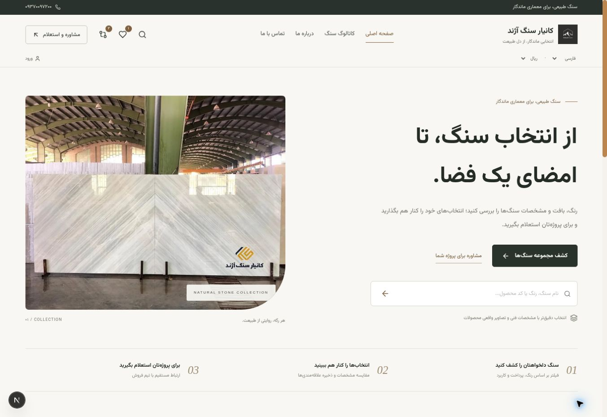

# بازطراحی رابط و اصلاح هشت ایراد

این تغییر روی شاخهٔ `arena/01a04dc4-stone-catalog-pro` پیاده شده است. رابط به API و PostgreSQL پروژه وصل است؛ داده‌های نمونهٔ پیش‌نمایش مستقل وارد دیتابیس اصلی نمی‌شوند.

## رابط عمومی و مدیریت

- سربرگ خوانا، فونت محلی وزیرمتن، چیدمان کرم/سبز تیره، معرفی دو ستونه، جستجو و مسیر انتخاب تا استعلام.
- کاتالوگ با فیلترهای قابل اشتراک در URL، کنترل خطای شبکه، لغو پاسخ‌های قدیمی و حالت بدون نتیجه.
- علاقه‌مندی‌ها با محصولات واقعی ذخیره‌شده و پشتیبانی از بیش از شش انتخاب؛ مقایسه با تصویر محدود، مشخصات بلافاصله قابل مشاهده و گزینهٔ «فقط تفاوت‌ها».
- مشخصات خالی با «ثبت نشده»، قیمت صفر/یک و قیمت منقضی با «نیاز به استعلام»، موجودی ناسازگار با درخواست تأیید. تبدیل ساختگی دلار/یورو حذف شده؛ فقط تبدیل دقیق ریال/تومان مجاز است.
- فرم استعلام دارای label واقعی، focus trap، بستن با Escape، خطای قابل مشاهده، متراژ اختیاری و کد پیگیری ذخیره‌شده در دیتابیس. شمارهٔ فارسی و لینک شبکه‌های اجتماعی نرمال می‌شوند.
- پنل با نوار کناری سبز تیره، مسیر تب در URL و شمارنده‌های واقعی کیفیت داده. امکانات CRUD، بارگذاری تصویر، قیمت، انبار، پیگیری و سایت‌ساز فعلی حفظ شده‌اند.
- تنظیمات SiteConfig از مدل واقعی Prisma خوانده و ذخیره می‌شود. محتوای ذخیره‌شده بازنویسی نمی‌شود. صفحهٔ قدیمیِ صرفاً تصویری، هنگام نمایش به معرفی دارای CTA ارتقا می‌یابد.
- Service Worker نسخهٔ جدید دارد؛ HTML و رسید پرداخت به‌عنوان منبع استاتیک کش نمی‌شوند.

## هشت اصلاح اصلی

| ایراد | رفتار اصلاح‌شده | پوشش بررسی |
|---|---|---|
| وابستگی‌های آسیب‌پذیر | به‌روزرسانی Next، sharp، Zod و SheetJS؛ نسخهٔ امن Blob و deepmerge؛ lockfile دقیق | audit تولیدی، typecheck، build و تست migration |
| ساخت OPERATOR با ورود عمومی | گوگل فقط حساب موجود با ایمیل تأییدشده؛ OTP عمومی فقط CUSTOMER؛ بررسی نقش جاری در دیتابیس | تست OAuth/OTP و دسترسی API با CUSTOMER |
| افشای قیمت همکاری در PDF | query و خروجی PDF فقط لایه‌های عمومی معتبر را می‌پذیرند | تست خروجی PDF و قیمت‌های API |
| اختلاف ریال/تومان در زرین‌پال | درخواست همیشه با ریال صحیح؛ مبلغ/واحد ارسالی روی Payment ثبت می‌شود؛ تأیید با همان مبلغ | تست payload برای IRR/IRT و callback |
| تخفیف دلخواه و سفارش با واحد اشتباه | تخفیف فقط مدیر فروش/مدیر؛ مجموع مثبت؛ نوع قیمت دقیق SQM/SLAB؛ اسلب با تعداد صحیح | تست جلوگیری از سفارش صفر و fallback اشتباه |
| خروج نمایشی و از دست رفتن نشست | فراخوانی logout، JWT متصل به Session قابل ابطال، hydration و تمدید با rotation اتمی و retry محدود | تست کوکی، توکن ذخیره‌شده، refresh و دیتابیس |
| ناهماهنگی امضای وب‌هوک | همان رشتهٔ شامل occurredAt امضا، صف و ارسال می‌شود؛ timeout ارسال | بررسی HMAC روی بایت‌های واقعی ارسالی |
| callback محافظت‌شده و صفحهٔ موفقیت غایب | GET callback عمومی، verify سمت سرور، ثبت اتمی دو رکورد و رسید امضاشدهٔ ۱۵ دقیقه‌ای | middleware، callback تکراری، receipt جعلی/منقضی |

مهاجرت اولیه نیز به UTF-8 اصلاح شده و CI به‌جای تکیه بر build، migration، تست، typecheck و audit را اجرا می‌کند. `db:push` دیگر گزینهٔ خودکار پذیرش حذف داده ندارد.

## استقرار

قبل از شروع نسخهٔ جدید، `npm run db:deploy` اجرا شود. برای دیتابیس قدیمی بدون تاریخچهٔ migration، دستورالعمل baseline در README را دنبال کنید. تراکنش‌های قدیمیِ در انتظار، مبلغ اصلیِ ارسال‌شده توسط نسخهٔ قبلی را برای verify حفظ می‌کنند. درخواست‌های جدید از واحد صریح ریال استفاده می‌کنند.

تست‌های درگاه از پاسخ شبیه‌سازی‌شده استفاده می‌کنند و وجه واقعی منتقل نمی‌کنند. اتصال نهایی در محیط استقرار به Merchant ID و callback واقعی همان محیط وابسته است.

## بررسی کاربری انجام‌شده

جستجوی کاتالوگ، نمایش علاقه‌مندی واقعی، انتخاب دو محصول برای مقایسه، نمایش تفاوت‌ها، مشخصات ناقص، ثبت استعلام با شماره فارسی، مشاهدهٔ کد پیگیری، دریافت آن در پنل، تغییر وضعیت به «تماس شده» و ماندگاری وضعیت بعد از رفرش، حفظ نشست پس از رفرش، خروج واقعی و بستن فرم با Escape در مرورگر بررسی شدند. صفحه در قاب موبایل ۳۹۰ پیکسلی بدون اسکرول افقی بود و فرم داخل عرض نمایشگر قرار گرفت. این بررسی در دیتابیس و نشست آزمایشی انجام شد و دادهٔ آزمایشی یا مسیر ورود مخصوص تست در نسخهٔ نهایی وجود ندارد.

تصویر زیر از همین پیاده‌سازی React و API واقعی، با رکوردهای آزمایشی و تصاویر موجود مخزن ثبت شده است:

